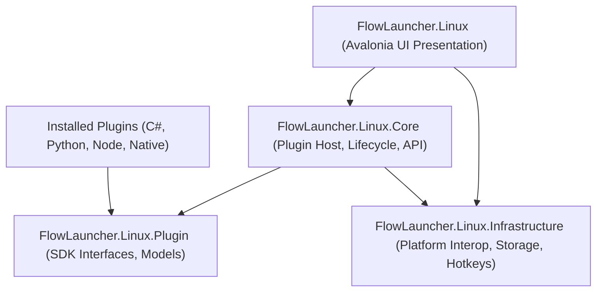

# Flow Launcher Linux Architecture

This document describes the internal design, cross-platform architecture, and subsystem mappings of the native Linux port of Flow Launcher.

---

## 1. High-Level Architecture

Flow Launcher Linux is built with **.NET 8** and **Avalonia UI**, cleanly decoupling UI presentation from the core business logic and system-level platform integrations.

---

## 2. Windows vs. Linux Implementation Mapping

| Subsystem | Windows Flow Launcher | Linux Port (Flow Launcher Linux) |
|---|---|---|
| **UI Framework** | WPF (.NET Desktop SDK) | **Avalonia UI 11.2** (Direct Rendering via Skia / X11 / Wayland) |
| **Window Blurring** | DWM Windows 11 Acrylic / Mica P/Invoke | `ExperimentalAcrylicBorder` with compositor blur |
| **Global Hotkey** | `NHotkey.Wpf` (`RegisterHotKey` Win32 API) | X11 `XGrabKey` / Wayland desktop custom shortcut hook |
| **App Discovery** | Windows Start Menu / Indexing Service | Standard XDG `.desktop` entry parser (`/usr/share/applications`, Flatpak) |
| **File Search** | Windows Search Index / Everything SDK | Fast `locate` (`plocate`/`mlocate`) + directory fallback indexing |
| **Notifications** | `Microsoft.Toolkit.Uwp.Notifications` | FreeDesktop `notify-send` / D-Bus notification protocol |
| **Process Control** | Win32 ToolHelp / `EnumProcesses` | POSIX `/proc` + `System.Diagnostics.Process` |
| **Terminal Runner** | `cmd.exe` / `powershell.exe` | Detected desktop terminal (`gnome-terminal`, `konsole`, `alacritty`, `kitty`, etc.) via `bash -c` |
| **Settings Storage** | Roaming AppData JSON | XDG Standard: `~/.config/flow-launcher/settings.json` |
| **Plugin Isolation** | Custom AppDomain / RPC Process | `AssemblyLoadContext` (C#) & Standard I/O JSON-RPC 2.0 (Python/Node) |

---

## 3. Project Breakdown

### `FlowLauncher.Linux`
- The executable host and presentation layer.
- Uses MVVM (CommunityToolkit.Mvvm) pattern with `MainViewModel` and `MainWindow`.
- Configured with headless and platform-detect flags for seamless startup on desktop environments.

### `FlowLauncher.Linux.Core`
- Plugin manager and orchestration engine.
- Manages plugin lifecycle (`InitAsync`, `QueryAsync`, `ReloadPluginsAsync`).
- Bridges RPC communications for non-C# plugins (Python scripts, Node.js scripts, executables) over stdin/stdout streams.

### `FlowLauncher.Linux.Infrastructure`
- Core system services:
  - `GlobalHotkeyService`: Interacts with `libX11.so.6` using low-level P/Invoke to register global keyboard shortcuts.
  - `XdgApplicationsScanner`: Recursively scans system and user application paths, parsing XDG Desktop Entry Specification compliance.
  - `LinuxHelper`: Encapsulates `xdg-open`, autostart configurations, and desktop environment introspection (`XDG_CURRENT_DESKTOP`).
  - `JsonStorage`: High-performance asynchronous System.Text.Json serialization engine.

### `FlowLauncher.Linux.Plugin`
- Cross-platform SDK providing definitions for `IPlugin`, `Query`, `Result`, and `IPublicAPI`.
- Shared dependency contract for all built-in and 3rd-party community plugins.
